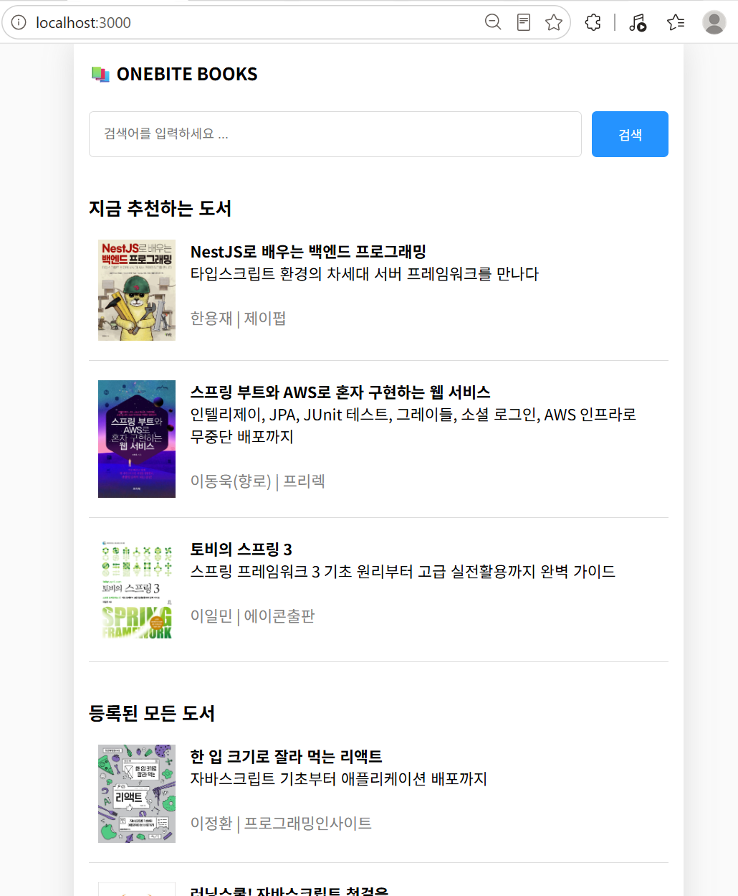

# week5

> 진도 : 강의 20-23
> 

#### SSR (서버 사이드 렌더링)

```tsx
// fetch-books.ts
import { BookData } from "@/types";

export default async function fetchBooks(
  q?: string
): Promise<BookData[]> {
  let url = `http://localhost:12345/book`;
  if (q) {
    url += `/search?q=${q}`;
  }

  try {
    const response = await fetch(url);
    return await response.json();
  } catch (err) {
    console.error(err);
    return [];
  }
}
```

```tsx
// index.tsx
import SearchableLayout from "@/components/searchable-layout";
import { useRouter } from "next/router";
import { ReactNode } from "react";

import BookItem from "@/components/book-item";
import {
  GetServerSidePropsContext,
  InferGetServerSidePropsType,
} from "next";
import fetchBooks from "@/lib/fetch-books";

export const getServerSideProps = async (
  context: GetServerSidePropsContext
) => {
  const q = context.query.q;
  const books = await fetchBooks(q as string);

  return {
    props: {
      books,
    },
  };
};

export default function Page({
  books,
}: InferGetServerSidePropsType<typeof getServerSideProps>) {
  return (
    <div>
      {books.map((book) => (
        <BookItem key={book.id} {...book} />
      ))}
    </div>
  );
}

Page.getLayout = (page: ReactNode) => {
  return <SearchableLayout>{page}</SearchableLayout>;
};
```

```tsx
// fetch-random-books.ts
import { BookData } from "@/types";

export default async function fetchRandomBooks(): Promise<
  BookData[]
> {
  const url = `http://localhost:12345/book/random`;

  try {
    const response = await fetch(url);
    return await response.json();
  } catch (err) {
    console.error(err);
    return [];
  }
}
```

```tsx
// index.tsx
// CSS Module
import SearchableLayout from "@/components/searchable-layout";
import style from "./index.module.css";
import { ReactNode, useEffect } from "react";
import books from "@/mock/books.json";
import BookItem from "@/components/book-item";
import { InferGetServerSidePropsType } from "next";
import fetchBooks from "@/lib/fetch-books";
import fetchRandomBooks from "@/lib/fetch-random-books";

export const getServerSideProps = async () => {
  const [allBooks, recoBooks] = await Promise.all([
    fetchBooks(),
    fetchRandomBooks(),
  ]);

  return {
    props: {
      allBooks,
      recoBooks,
    },
  };
};

export default function Home({
  allBooks,
  recoBooks,
}: InferGetServerSidePropsType<typeof getServerSideProps>) {
  return (
    <div className={style.container}>
      <section>
        <h3>지금 추천하는 도서</h3>
        {recoBooks.map((book) => (
          <BookItem key={book.id} {...book} />
        ))}
      </section>
      <section>
        <h3>등록된 모든 도서</h3>
        {allBooks.map((book) => (
          <BookItem key={book.id} {...book} />
        ))}
      </section>
    </div>
  );
}

Home.getLayout = (page: ReactNode) => {
  return <SearchableLayout>{page}</SearchableLayout>;
};
```

```tsx
// [id].tsx
import {
  GetServerSidePropsContext,
  InferGetServerSidePropsType,
} from "next";
import style from "./[id].module.css";
import fetchOneBook from "@/lib/fetch-one-book";

const mockData = {
  id: 1,
  title: "한 입 크기로 잘라 먹는 리액트",
  subTitle: "자바스크립트 기초부터 애플리케이션 배포까지",
  description:
    "자바스크립트 기초부터 애플리케이션 배포까지\n처음 시작하기 딱 좋은 리액트 입문서\n\n이 책은 웹 개발에서 가장 많이 사용하는 프레임워크인 리액트 사용 방법을 소개합니다. 인프런, 유데미에서 5000여 명이 수강한 베스트 강좌를 책으로 엮었습니다. 프런트엔드 개발을 희망하는 사람들을 위해 리액트의 기본을 익히고 다양한 앱을 구현하는 데 부족함이 없도록 만들었습니다. \n\n자바스크립트 기초 지식이 부족해 리액트 공부를 망설이는 분, 프런트엔드 개발을 희망하는 취준생으로 리액트가 처음인 분, 퍼블리셔나 백엔드에서 프런트엔드로 직군 전환을 꾀하거나 업무상 리액트가 필요한 분, 뷰, 스벨트 등 다른 프레임워크를 쓰고 있는데, 실용적인 리액트를 배우고 싶은 분, 신입 개발자이지만 자바스크립트나 리액트 기초가 부족한 분에게 유용할 것입니다.",
  author: "이정환",
  publisher: "프로그래밍인사이트",
  coverImgUrl:
    "https://shopping-phinf.pstatic.net/main_3888828/38888282618.20230913071643.jpg",
};

export const getServerSideProps = async (
  context: GetServerSidePropsContext
) => {
  const id = context.params!.id;
  const book = await fetchOneBook(Number(id));

  return {
    props: {
      book,
    },
  };
};

export default function Page({
  book,
}: InferGetServerSidePropsType<typeof getServerSideProps>) {
  if (!book) return "문제가 발생했습니다 다시 시도하세요";

  const {
    id,
    title,
    subTitle,
    description,
    author,
    publisher,
    coverImgUrl,
  } = book;

  return (
    <div className={style.container}>
      <div
        className={style.cover_img_container}
        style={{ backgroundImage: `url('${coverImgUrl}')` }}
      >
        
      </div>
      <div className={style.title}>{title}</div>
      <div className={style.subTitle}>{subTitle}</div>
      <div className={style.author}>
        {author} | {publisher}
      </div>
      <div className={style.description}>{description}</div>
    </div>
  );
}
```

```tsx
// fetch-one-book.ts
import { BookData } from "@/types";

export default async function fetchOneBook(
  id: number
): Promise<BookData | null> {
  const url = `http://localhost:12345/book/${id}`;

  try {
    const response = await fetch(url);
    return await response.json();
  } catch (err) {
    console.error(err);
    return null;
  }
}
```



실습 결과

#### SSG

- 사전 사이드 렌더링 SSR : 요청이 들어올 때마다 사전 렌더링 진행
- **정적 사이트 생성 SSG** : 빌드 타임에 미리 페이지를 사전 렌더링
    - 장점 : 사전 렌더링에 많은 시간을 소요되는 페이지더라도 
    사용자의 요청에는 매우 빠른 속도로 응답 가능
    - 단점 : 빌드 타임 이후에는 다시는 페이지를 사전 렌더링 하지 않기 때문에 
    언제 접속 요청을 보내도 매번 똑같은 페이지만 응답

### SSG - 정적 경로에 적용

```tsx
// index.tsx
// CSS Module
import SearchableLayout from "@/components/searchable-layout";
import style from "./index.module.css";
import { ReactNode, useEffect } from "react";
import books from "@/mock/books.json";
import BookItem from "@/components/book-item";
import {
  InferGetServerSidePropsType,
  InferGetStaticPropsType,
} from "next";
import fetchBooks from "@/lib/fetch-books";
import fetchRandomBooks from "@/lib/fetch-random-books";

export const getStaticProps = async () => {
  console.log("인덱스 페이지");

  const [allBooks, recoBooks] = await Promise.all([
    fetchBooks(),
    fetchRandomBooks(),
  ]);

  return {
    props: {
      allBooks,
      recoBooks,
    },
  };
};

export default function Home({
  allBooks,
  recoBooks,
}: InferGetStaticPropsType<typeof getStaticProps>) {
  return (
    <div className={style.container}>
      <section>
        <h3>지금 추천하는 도서</h3>
        {recoBooks.map((book) => (
          <BookItem key={book.id} {...book} />
        ))}
      </section>
      <section>
        <h3>등록된 모든 도서</h3>
        {allBooks.map((book) => (
          <BookItem key={book.id} {...book} />
        ))}
      </section>
    </div>
  );
}

Home.getLayout = (page: ReactNode) => {
  return <SearchableLayout>{page}</SearchableLayout>;
};
```

```tsx
// search/index.tsx
import SearchableLayout from "@/components/searchable-layout";
import { useRouter } from "next/router";
import { ReactNode, useEffect, useState } from "react";

import BookItem from "@/components/book-item";
import {
  GetServerSidePropsContext,
  GetStaticPropsContext,
  InferGetServerSidePropsType,
} from "next";
import fetchBooks from "@/lib/fetch-books";
import { BookData } from "@/types";

// export const getStaticProps = async (
//   context: GetStaticPropsContext
// ) => {
//   const q = context.query.q;
//   const books = await fetchBooks(q as string);

//   return {
//     props: {
//       books,
//     },
//   };
// };

export default function Page() {
  const [books, setBooks] = useState<BookData[]>([]);

  const router = useRouter();
  const q = router.query.q;

  const fetchSearchResult = async () => {
    const data = await fetchBooks(q as string);
    setBooks(data);
  };

  useEffect(() => {
    if (q) {
      fetchSearchResult();
    }
  }, [q]);

  return (
    <div>
      {books.map((book) => (
        <BookItem key={book.id} {...book} />
      ))}
    </div>
  );
}

Page.getLayout = (page: ReactNode) => {
  return <SearchableLayout>{page}</SearchableLayout>;
};
```

### SSG - 동적 경로에 적용

```tsx
// [id].tsx
import {
  GetServerSidePropsContext,
  GetStaticPropsContext,
  InferGetServerSidePropsType,
  InferGetStaticPropsType,
} from "next";
import style from "./[id].module.css";
import fetchOneBook from "@/lib/fetch-one-book";

const mockData = {
  id: 1,
  title: "한 입 크기로 잘라 먹는 리액트",
  subTitle: "자바스크립트 기초부터 애플리케이션 배포까지",
  description:
    "자바스크립트 기초부터 애플리케이션 배포까지\n처음 시작하기 딱 좋은 리액트 입문서\n\n이 책은 웹 개발에서 가장 많이 사용하는 프레임워크인 리액트 사용 방법을 소개합니다. 인프런, 유데미에서 5000여 명이 수강한 베스트 강좌를 책으로 엮었습니다. 프런트엔드 개발을 희망하는 사람들을 위해 리액트의 기본을 익히고 다양한 앱을 구현하는 데 부족함이 없도록 만들었습니다. \n\n자바스크립트 기초 지식이 부족해 리액트 공부를 망설이는 분, 프런트엔드 개발을 희망하는 취준생으로 리액트가 처음인 분, 퍼블리셔나 백엔드에서 프런트엔드로 직군 전환을 꾀하거나 업무상 리액트가 필요한 분, 뷰, 스벨트 등 다른 프레임워크를 쓰고 있는데, 실용적인 리액트를 배우고 싶은 분, 신입 개발자이지만 자바스크립트나 리액트 기초가 부족한 분에게 유용할 것입니다.",
  author: "이정환",
  publisher: "프로그래밍인사이트",
  coverImgUrl:
    "https://shopping-phinf.pstatic.net/main_3888828/38888282618.20230913071643.jpg",
};

export const getStaticPaths = () => {
  return {
    paths: [
      { params: { id: "1" } },
      { params: { id: "2" } },
      { params: { id: "3" } },
    ],
    fallback: false,
  };
};

export const getStaticProps = async (
  context: GetStaticPropsContext
) => {
  const id = context.params!.id;
  const book = await fetchOneBook(Number(id));

  return {
    props: {
      book,
    },
  };
};

export default function Page({
  book,
}: InferGetStaticPropsType<typeof getStaticProps>) {
  if (!book) return "문제가 발생했습니다 다시 시도하세요";

  const {
    id,
    title,
    subTitle,
    description,
    author,
    publisher,
    coverImgUrl,
  } = book;

  return (
    <div className={style.container}>
      <div
        className={style.cover_img_container}
        style={{ backgroundImage: `url('${coverImgUrl}')` }}
      >
        
      </div>
      <div className={style.title}>{title}</div>
      <div className={style.subTitle}>{subTitle}</div>
      <div className={style.author}>
        {author} | {publisher}
      </div>
      <div className={style.description}>{description}</div>
    </div>
  );
}
```