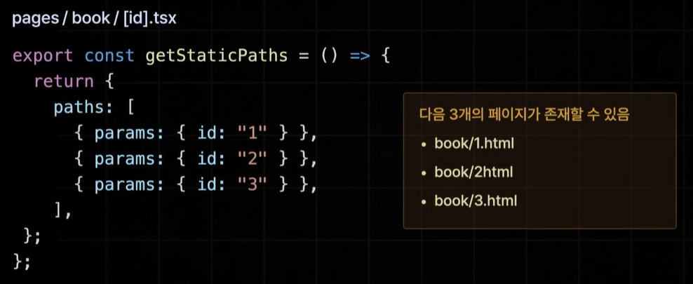

# week6

> 진도 : 강의 24-29
> 

### SSG - Fallback 옵션 설정




Fallback 옵션 설정


fallback true 옵션

```tsx
// [id].tsx
import {
  GetServerSidePropsContext,
  GetStaticPropsContext,
  InferGetServerSidePropsType,
  InferGetStaticPropsType,
} from "next";
import style from "./[id].module.css";
import fetchOneBook from "@/lib/fetch-one-book";
import { useRouter } from "next/router";

const mockData = {
  id: 1,
  title: "한 입 크기로 잘라 먹는 리액트",
  subTitle: "자바스크립트 기초부터 애플리케이션 배포까지",
  description:
    "자바스크립트 기초부터 애플리케이션 배포까지\n처음 시작하기 딱 좋은 리액트 입문서\n\n이 책은 웹 개발에서 가장 많이 사용하는 프레임워크인 리액트 사용 방법을 소개합니다. 인프런, 유데미에서 5000여 명이 수강한 베스트 강좌를 책으로 엮었습니다. 프런트엔드 개발을 희망하는 사람들을 위해 리액트의 기본을 익히고 다양한 앱을 구현하는 데 부족함이 없도록 만들었습니다. \n\n자바스크립트 기초 지식이 부족해 리액트 공부를 망설이는 분, 프런트엔드 개발을 희망하는 취준생으로 리액트가 처음인 분, 퍼블리셔나 백엔드에서 프런트엔드로 직군 전환을 꾀하거나 업무상 리액트가 필요한 분, 뷰, 스벨트 등 다른 프레임워크를 쓰고 있는데, 실용적인 리액트를 배우고 싶은 분, 신입 개발자이지만 자바스크립트나 리액트 기초가 부족한 분에게 유용할 것입니다.",
  author: "이정환",
  publisher: "프로그래밍인사이트",
  coverImgUrl:
    "https://shopping-phinf.pstatic.net/main_3888828/38888282618.20230913071643.jpg",
};

export const getStaticPaths = () => {
  return {
    paths: [
      { params: { id: "1" } },
      { params: { id: "2" } },
      { params: { id: "3" } },
    ],
    fallback: true,
    // false : 404 Notfound
    // blocking : SSR 방식
    // true : SRR 방식 + 데이터가 없는 폴백 상태의 페이지부터 반환
  };
};

export const getStaticProps = async (
  context: GetStaticPropsContext
) => {
  const id = context.params!.id;
  const book = await fetchOneBook(Number(id));

  if (!book) {
    return {
      notFound: true,
    };
  }

  return {
    props: {
      book,
    },
  };
};

export default function Page({
  book,
}: InferGetStaticPropsType<typeof getStaticProps>) {
  const router = useRouter();

  if (router.isFallback) return "로딩중입니다";
  if (!book) return "문제가 발생했습니다 다시 시도하세요";

  const {
    id,
    title,
    subTitle,
    description,
    author,
    publisher,
    coverImgUrl,
  } = book;

  return (
    <div className={style.container}>
      <div
        className={style.cover_img_container}
        style={{ backgroundImage: `url('${coverImgUrl}')` }}
      >
        
      </div>
      <div className={style.title}>{title}</div>
      <div className={style.subTitle}>{subTitle}</div>
      <div className={style.author}>
        {author} | {publisher}
      </div>
      <div className={style.description}>{description}</div>
    </div>
  );
}
```

- false : path에 설정하지 않은 경로는 모두 404
- blocking : SSR 방식으로 실시간으로 페이지 생성 (사전 렌더링)
- true : fallback 상태의 페이지(Props 데이터가 없는 상태의 페이지)부터 생성해 보냄

### ISR

- 중분 정적 재생성 (ISR, Incremental Static Regeneration)
    - **SSG 방식으로 생성된 정적 페이지를 일정 시간을 주기로 다시 생성하는 기술**
- 매우 빠른 속도로 응답 가능 (기존 SSG 방식의 장점) + 최신 데이터 반영 가능 (기존 SSR 방식의 장점)

```tsx
// index.tsx
// CSS Module
import SearchableLayout from "@/components/searchable-layout";
import style from "./index.module.css";
import { ReactNode, useEffect } from "react";
import books from "@/mock/books.json";
import BookItem from "@/components/book-item";
import {
  InferGetServerSidePropsType,
  InferGetStaticPropsType,
} from "next";
import fetchBooks from "@/lib/fetch-books";
import fetchRandomBooks from "@/lib/fetch-random-books";

export const getStaticProps = async () => {
  console.log("인덱스 페이지");

  const [allBooks, recoBooks] = await Promise.all([
    fetchBooks(),
    fetchRandomBooks(),
  ]);

  return {
    props: {
      allBooks,
      recoBooks,
    },
    revalidate: 3,
  };
};

export default function Home({
  allBooks,
  recoBooks,
}: InferGetStaticPropsType<typeof getStaticProps>) {
  return (
    <div className={style.container}>
      <section>
        <h3>지금 추천하는 도서</h3>
        {recoBooks.map((book) => (
          <BookItem key={book.id} {...book} />
        ))}
      </section>
      <section>
        <h3>등록된 모든 도서</h3>
        {allBooks.map((book) => (
          <BookItem key={book.id} {...book} />
        ))}
      </section>
    </div>
  );
}

Home.getLayout = (page: ReactNode) => {
  return <SearchableLayout>{page}</SearchableLayout>;
};
```

- 새로고침 진행하면 3초 주기로 변경되는 모습
    
    
    
    
    

### ISR - 주문형 재 검증

- 주문형 재 검증 (On-Demand-ISR)
- 시간 기반의 ISR을 적용하기 어려운 페이지도 존재
    - 시간과 관계없이 사용자의 행동에 따라 데이터가 업데이트 되는 페이지
- **요청을 받을 때마다 페이지를 다시 생성하는 ISR**

```tsx
// index.tsx
// CSS Module
import SearchableLayout from "@/components/searchable-layout";
import style from "./index.module.css";
import { ReactNode, useEffect } from "react";
import books from "@/mock/books.json";
import BookItem from "@/components/book-item";
import {
  InferGetServerSidePropsType,
  InferGetStaticPropsType,
} from "next";
import fetchBooks from "@/lib/fetch-books";
import fetchRandomBooks from "@/lib/fetch-random-books";

export const getStaticProps = async () => {
  console.log("인덱스 페이지");

  const [allBooks, recoBooks] = await Promise.all([
    fetchBooks(),
    fetchRandomBooks(),
  ]);

  return {
    props: {
      allBooks,
      recoBooks,
    },
  };
};

export default function Home({
  allBooks,
  recoBooks,
}: InferGetStaticPropsType<typeof getStaticProps>) {
  return (
    <div className={style.container}>
      <section>
        <h3>지금 추천하는 도서</h3>
        {recoBooks.map((book) => (
          <BookItem key={book.id} {...book} />
        ))}
      </section>
      <section>
        <h3>등록된 모든 도서</h3>
        {allBooks.map((book) => (
          <BookItem key={book.id} {...book} />
        ))}
      </section>
    </div>
  );
}

Home.getLayout = (page: ReactNode) => {
  return <SearchableLayout>{page}</SearchableLayout>;
};
```

```tsx
// revalidate.ts
import { NextApiRequest, NextApiResponse } from "next";

export default async function handler(
  req: NextApiRequest,
  res: NextApiResponse
) {
  try {
    await res.revalidate("/");
    return res.json({ revalidate: true });
  } catch (err) {
    res.status(500).send("Revalidation Failed");
  }
}
```


### SEO 설정

- 검색 엔진 최적화 설정
- 파비콘 교체 완료
    
    
    
- 페이지별 메타 태그 설정
    
    ```tsx
    // index.tsx
    import SearchableLayout from "@/components/searchable-layout";
    import style from "./index.module.css";
    import { ReactNode } from "react";
    import BookItem from "@/components/book-item";
    import { InferGetStaticPropsType } from "next";
    import fetchBooks from "@/lib/fetch-books";
    import fetchRandomBooks from "@/lib/fetch-random-books";
    import Head from "next/head";
    
    export const getStaticProps = async () => {
      const [allBooks, recoBooks] = await Promise.all([
        fetchBooks(),
        fetchRandomBooks(),
      ]);
    
      return {
        props: {
          allBooks,
          recoBooks,
        },
      };
    };
    
    export default function Home({
      allBooks,
      recoBooks,
    }: InferGetStaticPropsType<typeof getStaticProps>) {
      return (
        <>
          <Head>
            <title>한입북스</title>
            <meta property="og:image" content="/thumbnail.png" />
            <meta property="og:title" content="한입북스" />
            <meta
              property="og:description"
              content="한입 북스에 등록된 도서들을 만나보세요"
            />
          </Head>
          <div className={style.container}>
            <section>
              <h3>지금 추천하는 도서</h3>
              {recoBooks.map((book) => (
                <BookItem key={book.id} {...book} />
              ))}
            </section>
            <section>
              <h3>등록된 모든 도서</h3>
              {allBooks.map((book) => (
                <BookItem key={book.id} {...book} />
              ))}
            </section>
          </div>
        </>
      );
    }
    
    Home.getLayout = (page: ReactNode) => {
      return <SearchableLayout>{page}</SearchableLayout>;
    };
    ```
    
    ```tsx
    // [id].tsx
    import {
      GetServerSidePropsContext,
      GetStaticPropsContext,
      InferGetServerSidePropsType,
      InferGetStaticPropsType,
    } from "next";
    import style from "./[id].module.css";
    import fetchOneBook from "@/lib/fetch-one-book";
    import { useRouter } from "next/router";
    import Head from "next/head";
    
    const mockData = {
      id: 1,
      title: "한 입 크기로 잘라 먹는 리액트",
      subTitle: "자바스크립트 기초부터 애플리케이션 배포까지",
      description:
        "자바스크립트 기초부터 애플리케이션 배포까지\n처음 시작하기 딱 좋은 리액트 입문서\n\n이 책은 웹 개발에서 가장 많이 사용하는 프레임워크인 리액트 사용 방법을 소개합니다. 인프런, 유데미에서 5000여 명이 수강한 베스트 강좌를 책으로 엮었습니다. 프런트엔드 개발을 희망하는 사람들을 위해 리액트의 기본을 익히고 다양한 앱을 구현하는 데 부족함이 없도록 만들었습니다. \n\n자바스크립트 기초 지식이 부족해 리액트 공부를 망설이는 분, 프런트엔드 개발을 희망하는 취준생으로 리액트가 처음인 분, 퍼블리셔나 백엔드에서 프런트엔드로 직군 전환을 꾀하거나 업무상 리액트가 필요한 분, 뷰, 스벨트 등 다른 프레임워크를 쓰고 있는데, 실용적인 리액트를 배우고 싶은 분, 신입 개발자이지만 자바스크립트나 리액트 기초가 부족한 분에게 유용할 것입니다.",
      author: "이정환",
      publisher: "프로그래밍인사이트",
      coverImgUrl:
        "https://shopping-phinf.pstatic.net/main_3888828/38888282618.20230913071643.jpg",
    };
    
    export const getStaticPaths = () => {
      return {
        paths: [
          { params: { id: "1" } },
          { params: { id: "2" } },
          { params: { id: "3" } },
        ],
        fallback: true,
        // false : 404 Notfound
        // blocking : SSR 방식
        // true : SRR 방식 + 데이터가 없는 폴백 상태의 페이지부터 반환
      };
    };
    
    export const getStaticProps = async (
      context: GetStaticPropsContext
    ) => {
      const id = context.params!.id;
      const book = await fetchOneBook(Number(id));
    
      if (!book) {
        return {
          notFound: true,
        };
      }
    
      return {
        props: {
          book,
        },
      };
    };
    
    export default function Page({
      book,
    }: InferGetStaticPropsType<typeof getStaticProps>) {
      const router = useRouter();
    
      if (router.isFallback) {
        return (
          <>
            <Head>
              <title>한입북스</title>
              <meta property="og:image" content="/thumbnail.png" />
              <meta property="og:title" content="한입북스" />
              <meta
                property="og:description"
                content="한입 북스에 등록된 도서들을 만나보세요"
              />
            </Head>
            <div>로딩중입니다</div>
          </>
        );
      }
      if (!book) return "문제가 발생했습니다 다시 시도하세요";
    
      const {
        id,
        title,
        subTitle,
        description,
        author,
        publisher,
        coverImgUrl,
      } = book;
    
      return (
        <>
          <Head>
            <title>{title}</title>
            <meta property="og:image" content={coverImgUrl} />
            <meta property="og:title" content={title} />
            <meta property="og:description" content={description} />
          </Head>
          <div className={style.container}>
            <div
              className={style.cover_img_container}
              style={{ backgroundImage: `url('${coverImgUrl}')` }}
            >
              
            </div>
            <div className={style.title}>{title}</div>
            <div className={style.subTitle}>{subTitle}</div>
            <div className={style.author}>
              {author} | {publisher}
            </div>
            <div className={style.description}>{description}</div>
          </div>
        </>
      );
    }
    ```
    

### 프로젝트 배포

- Vercel에 Next.js 빌드할 수 있는 도구 설치 : `npm install -g vercel`
- 터미널 상에서 Vercel 로그인 : `vercel login`