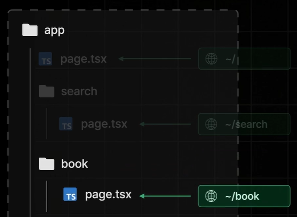

# week7

### App Router

- Next.js 13 버전에 새롭게 추가된 라우터
- 기존 Page Router 완전히 대체
    - 페이지 라우팅 설정 방식 변경
    - 레이아웃 설정 방식 변경
    - 데이터 페칭 방식 변경
    - React 18 신규 기능 추가
- 변경되지 않는 사항 : 네비게이터, 프리페칭, 사전 렌더링

### 페이지 라우팅 설정

- App 폴더 기준으로 라우팅 설정
    
    
    
    
    

```tsx
// page.tsx
import styles from "./page.module.css";

export default function Home() {
  return <div className={styles.page}>인덱스 페이지</div>;
}
```

```tsx
// search/page.tsx
export default async function Page({
  searchParams,
}: {
  searchParams: Promise<{ q?: string }>;
}) {
  const { q } = await searchParams;

  return <div>Search 페이지 {q}</div>;
}
```

```tsx
// book/[id]/page.tsx
export default async function Page({
  params,
}: {
  params: Promise<{ id: string | string[] }>;
}) {
  const { id } = await params;

  return <div>book/[id] 페이지 {id}</div>;
}
```

### 레이아웃 설정


- 폴더명을 소괄호로 감싸게 되면 해당 폴더는 경로에 더 이상 영향을 미치지 않음

```tsx
// (with-searchbar)/layout.tsx
import { ReactNode } from "react";

export default function Layout({
  children,
}: {
  children: ReactNode;
}) {
  return (
    <div>
      <div>임시 서치바</div>
      {children}
    </div>
  );
}
```

### 리액트 서버 컴포넌트

- React 18v부터 새롭게 추가된 새로운 유형의 컴포넌트
- 서버 측에서만 실행되는 컴포넌트 (브라우저에서 실행 X)

#### 서버 컴포넌트 등장 계기


- 서버 측에서 사전 렌더링을 진행할 때 딱 한 번만 실행 되어야 함
    - 그 이후에는 더 이상 실행될 필요가 없도록 만들어 줘야 함

#### 서버 컴포넌트


- 서버에서만 실행되는 컴포넌트를 리액트 서버 컴포넌트라고 분류
    - 그렇지 않은 컴포너트를 클라이언트 컴포넌트


- 페이지 대부분을 서버 컴포넌트로 구성할 것을 권장
    - 클라이언트 컴포넌트는 꼭 필요한 경우에만 사용할 것

```tsx
// (with-searchbar)/searchbar.tsx
"use client";

import { useState } from "react";

export default function Searchbar() {
  const [search, setSearch] = useState("");

  const onChangeSearch = (e: React.ChangeEvent<HTMLInputElement>) => {
    setSearch(e.target.value);
  };

  return (
    <div>
      <input value={search} onChange={onChangeSearch} />
      <button>검색</button>
    </div>
  );
}
```

```tsx
// (with-searchbar)/layout.tsx
import { ReactNode } from "react";
import Searchbar from "./searchbar";

export default function Layout({
  children,
}: {
  children: ReactNode;
}) {
  return (
    <div>
      <Searchbar />
      {children}
    </div>
  );
}
```