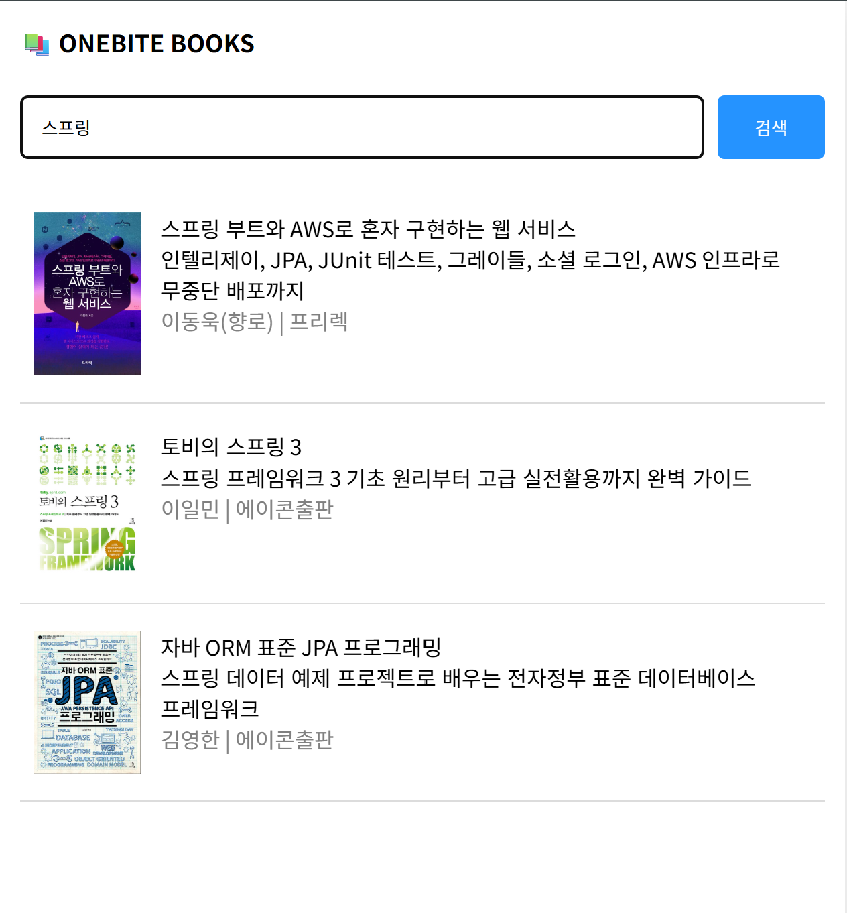
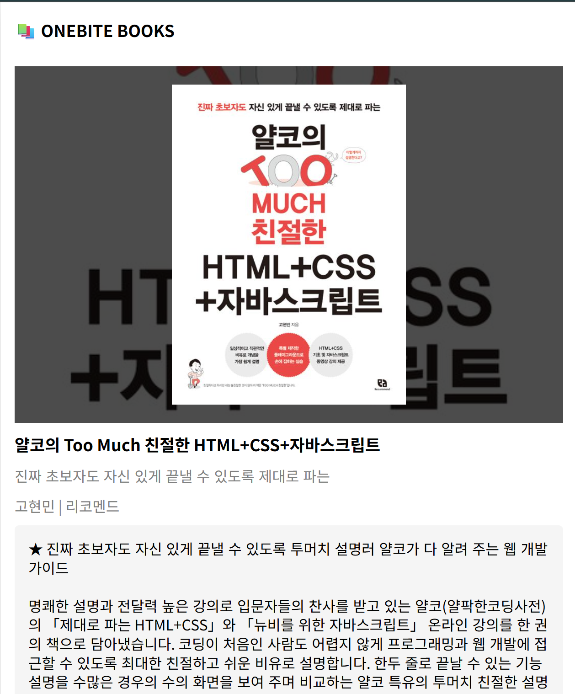
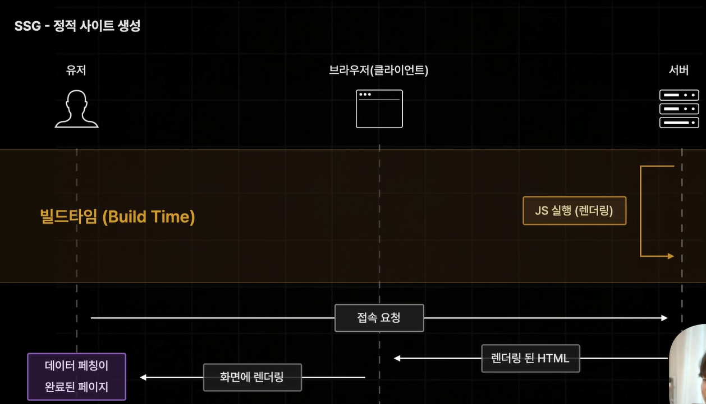
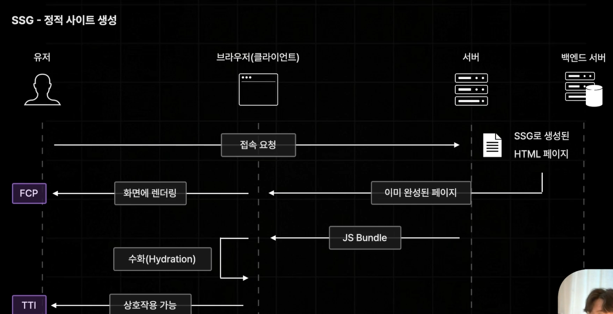
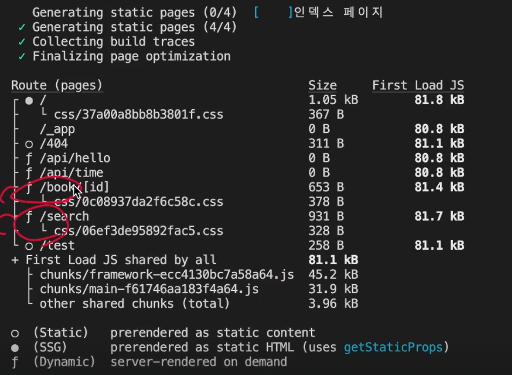
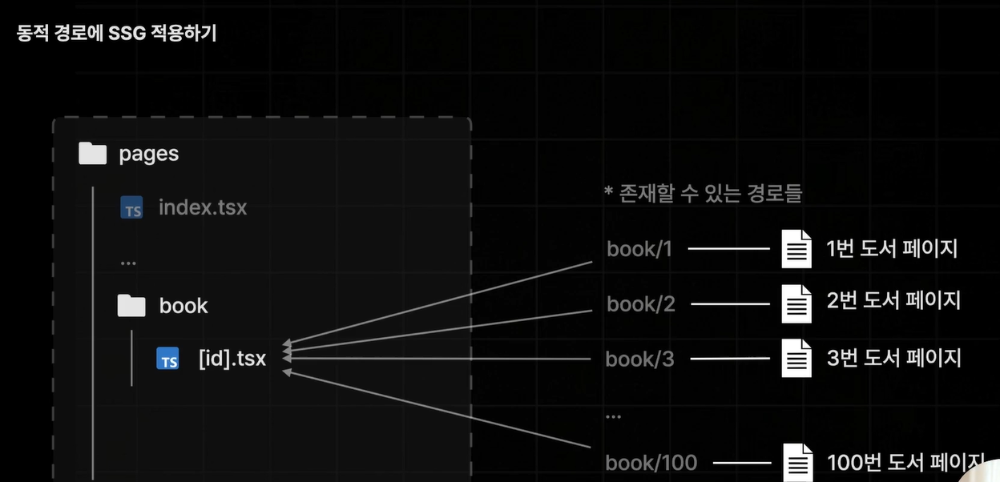
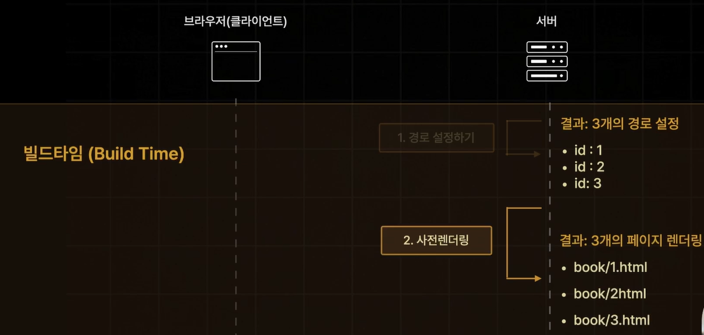
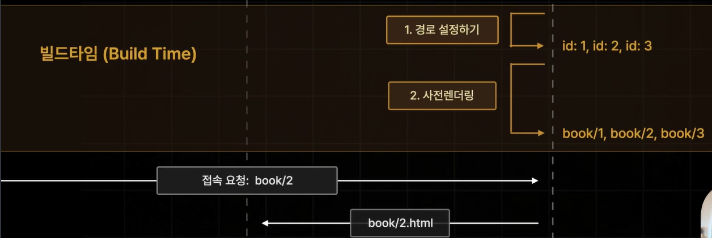
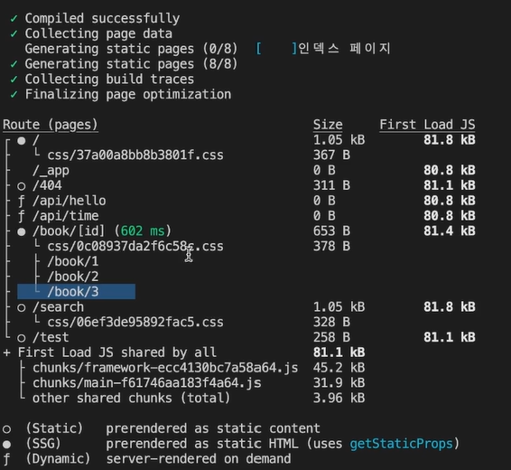

## SSR(서버 사이드 렌더링) 실습

-서버 복구

-page 수정하기

## SSG 1.소개

**서버 사이드 렌더링(SSR)**

:가장 기본적인 사전 렌더링 방식

:요청이 들어올때마다 사전 렌더링 실행됨

:현재 이 페이지가 백엔드 서버가 필요한 방식이라면 새로운 방식을 매번 요청해야함.

:항상 최신 버전으로 데이터 유지 가능

:장점 - 페이지 내부의 데이터를 항상 최신으로 유지 가능

:단점 - 데이터 요청이 늦어질 경우 모든 것이 늦어짐

**정적 사이트 생성(SSG)**

:SSR의 단점을 해결하는 사전 렌더링 방식

:빌드 타임에 미리 페이지를 사전 렌더링 해 둠

:빌드 타임 이후 일어나는 접속 요청에 대해 굉장히 빠르게 전달 가능

:장점 - 사전 렌더링에 많은 시간이 소요되는 페이지더라도 사용자의 요청에는 매우 빠른 속도로 응답 가능

:단점 - 매번 똑같은 페이지만 응답함, 최신 데이터 반영은 어렵다

## SSG 2. 정적 경로에 적용하기

SSR 기호 붙어있음 (dynamic 등)

f: dynamic
빈 동그라미: static(기본값 SSG 페이지)
채워진 동그라미: static HTML(uses getStaticProps)

계속 새로고침하더라도 서버측에 아무런 메시지가 실행되지 않음

## SSG 3. 동적 경로에 적용하기

getStaticPaths is required for dynamic SSG pages and is missing for '/book/[id]'

:dynamic한 경로를 갖는 SSG페이지에는 getStaticPaths 함수가 추가로 필요하다.

Build Time

[id].tsx 사전 렌더링

사전렌더링 이전에 경로 설정하는 작업이 반드시 필요

경로 각각 직접 설정하는 방법 : **getStaticPaths** 함수 사용

