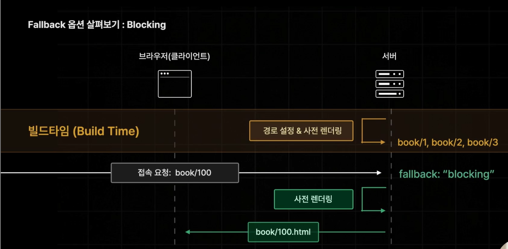
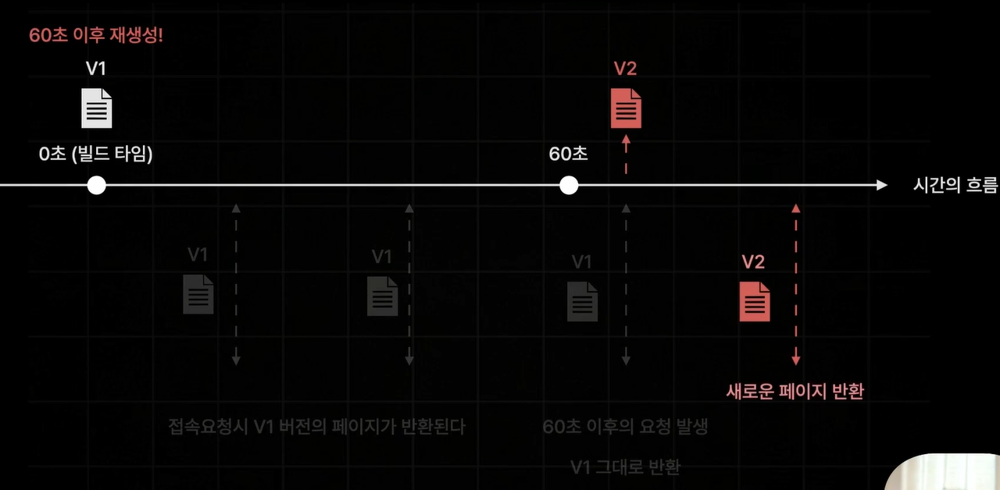
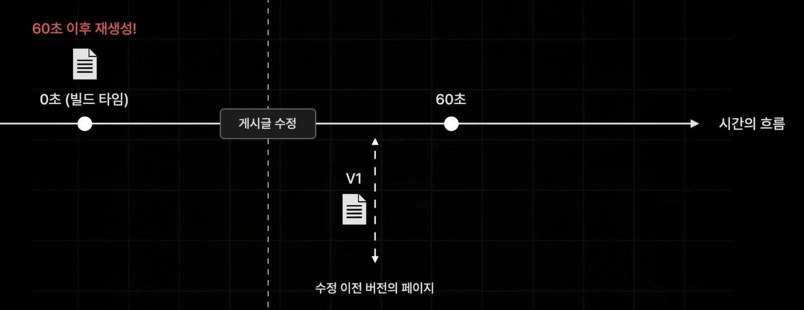
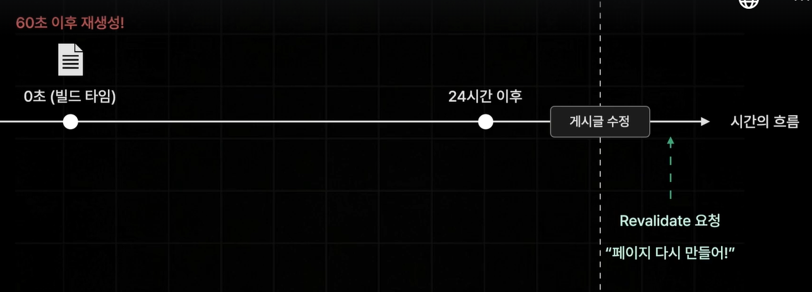

## SSG. 플백옵션 설정하기

첫번째 요청때는 SSR, 그 이후에는 SSG방식 사용

blocking 사용 시 주의할 점: 사전 렌더링 시간이 길어질 경우 로딩이 발생할 수 있음

=> 해결: `fallback: true`

`fallback: true`

-> Props없는 페이지(getStaticProps로부터 받은 데이터가 없는 페이지) 반환

-> 그 이후 Rrops 계산 후 Props만 따로 반환

-> 데이터가 있는 상태의 페이지 렌더링

최종 정리

`false`: path에 설정하지 않은 경로는 모두 404

`blocking`: SSR 방시으로 실시간으로 페이지 생성(사전렌더링)

`true`: fallback 상태의 페이지(Props 데이터가 없는 상태의 페이지)부터 생성해 보내줌

## ISR 1. 소개 및 실습

**ISR**: Incremental Static Regeneration

:단순히 그냥 SSG 방식으로 생성된 정적 페이지를 일정 시간을 주기로 다시 생성하는 기술

장점: 매우 빠른 속도로 응답 가능(SSG) + 최신 데이터 반영 가능(SSR)

## ISR2. 주문형 재 검증

시간 기반의 ISR을 적용하기 어려운 페이지

-> 시간과 관계없이 사용자의 행동에 따라 데이터가 업데이트 되는 페이지

ex.커뮤니티 사이트의 게시글 페이지

- 게시글 수정: 페이지 데이터 업데이트 해야함

- 게시글 삭제: 게시글 삭제해야함

**On-Demand ISR**

:요청을 받을 때마다 페이지를 다시 생성하는 ISR

## SEO 설정하기

## 배포하기

vercel로 배포

- vercel로 회원가입

- cmd 창에 `npm install -g vercel` -> vercel 설치

* 권한 오류 발생 시: `sudo` 키워드 설치

* windowsOS 오류: 파워셀이나 CMD 관리자

- cmd 창에 `vercel login` 명령어 입력

- 이메일로 로그인

- `vercel` 명령어 입력

- `Y` 입력

- 어떤 계정에 업로드할거냐? winterlood-lab

- `N` 입력

- onebite-books-page 입력 (프로젝트 이름)

- 'N' 입력

- 주소로 직접 접근

-> 도서 데이터 전혀 없음 (백엔드서버로부터 데이터 불러오지 못하기 때문)

---

server 배포

- server 프로젝트 vsc로 들어가기

- 터미널창에 `vercel` 입력

- `Y`

- 엔터

- `no`

- 기본값

- enter누르기

---

vsc 코드로 다시 돌아가기

lib에 있는 fetch 프로그램들 URL 교체

다시 터미널에 `vercel --prod` 입력

## 페이지 라우터 정리

Page Router의 장점

1. 파일 시스템 기반 간편한 페이지 라우팅 제공

2. 다양한 방식의 사전 렌더링 제공

--

1.서버사이드렌더링(SSR)

2.정적사이트생성(SSG)

3.증분 정적 재생성(ISR)

--

Page Router의 단점

1. 페이지별 레이아웃 설정이 번거롭다

2. 데이터 페칭이 페이지 컴포넌트에 집중된다

3. 불필요한 컴포넌트들도 JS Bundle에 포함된다
