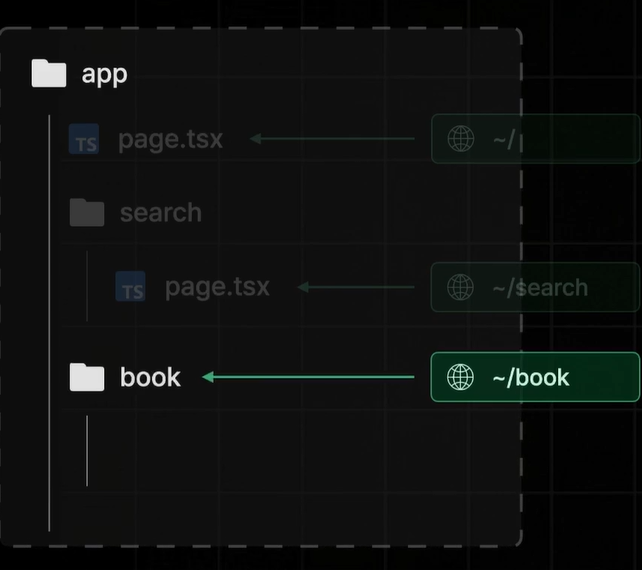
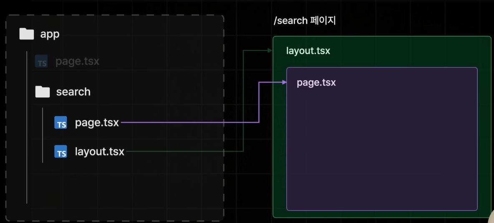
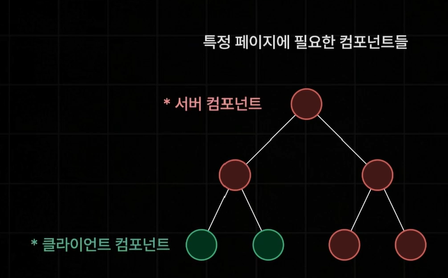
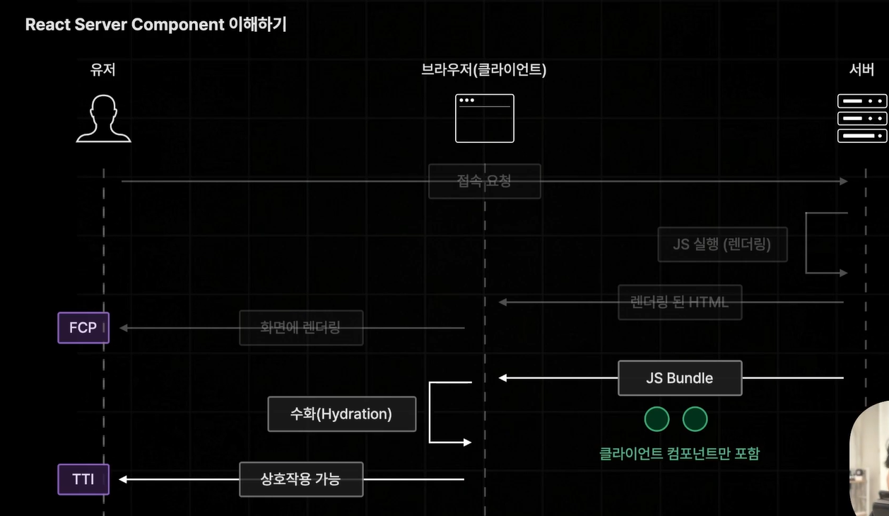
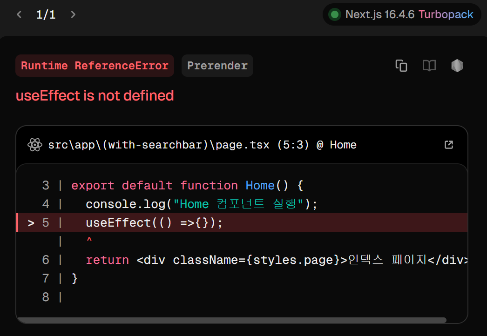

## App Router 시작하기

App Router

: Next.js 13 버전에 새롭게 추가된 라우터

: 기존의 Page Router 완전히 대체함

[App Router 변경되거나 추가되는 사항]

- 페이지 라우팅 설정 방식 변경

- 레이아웃 설정 방식 변경

- 데이터 페칭 방식 변경

## 페이지 라우팅 설정하기

경로 폴더를 만들고 그 아래에 page.tsx 넣어야함.

## 레이아웃 설정하기

route group: 경로상 영향 미치지 않음 + 각기 경로를 갖는 파일들 하나로 묶음 + 레이아웃 동일하게 적용 가능

## 리액트 서버 컴포넌트 이해하기

React Server Component

: 서버측에서만 실행되는 컴포넌트 (브라우저에서는 X)

Server Component 이전 -Page Router 버전의 Next.js는 어떤 문제가 있었을까?

사전렌더링 과정에서 JS Bundle 과정에서 상호작용이 없는 컴포넌트들은 브라우저에서 하이드레이션이 될 필요가 없는 컴포넌트는 아애 빼버리면 문제가 해결됨

-> JS Bundle 용량이 줄어들어서 시간 절약 가능

React Server Component

: 서버측에서만 실행되는 컴포넌트(브라우저에서 실행X)

서버 컴포넌트: 서버측에서 사전렌더링 진행할 때 딱 한번만 실행됨

클라이언트 컴포넌트: 사전렌더링, 하이드레이션 진행 과정에서 각각 1번씩 실행됨

페이지의 대부분을 서버 컴포넌트로 구성할 것을 권장. 클라이언트 컴포넌트는 꼭 필요한 경우에만 사용할 것

기본적으로 서버컴포넌트로 실행

->use Effect는 브라우저에서만 실행 가능해서 오류 발생

-> 해결법: `"use client":` 최상단에 적기

상호작용이 있어야하면 클라이언트 컴포넌트, 그 이외에는 전부 서버 컴포넌트로 설정
